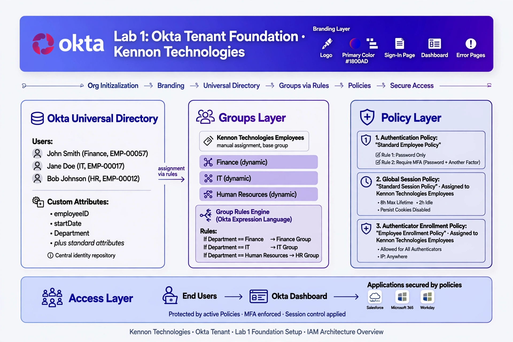
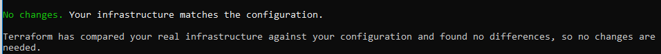
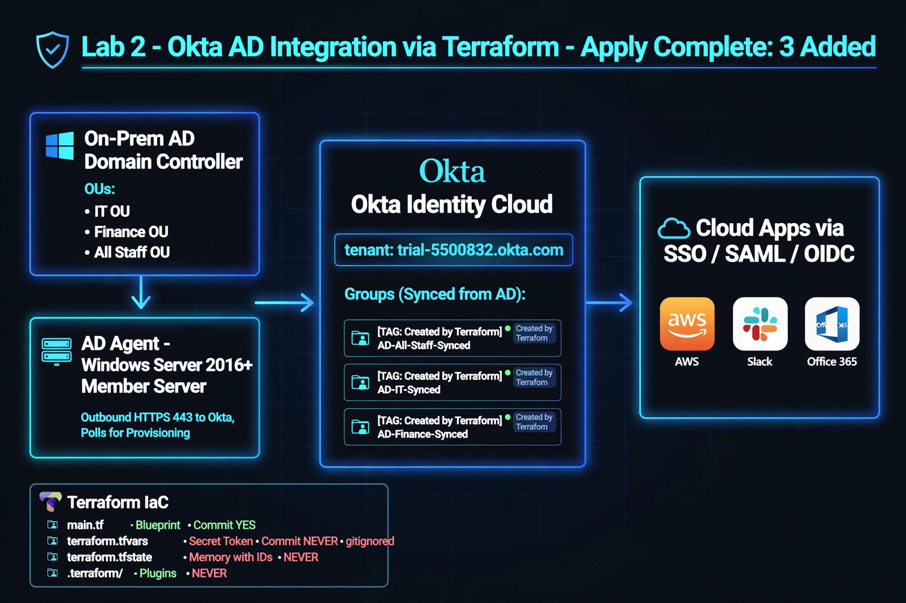
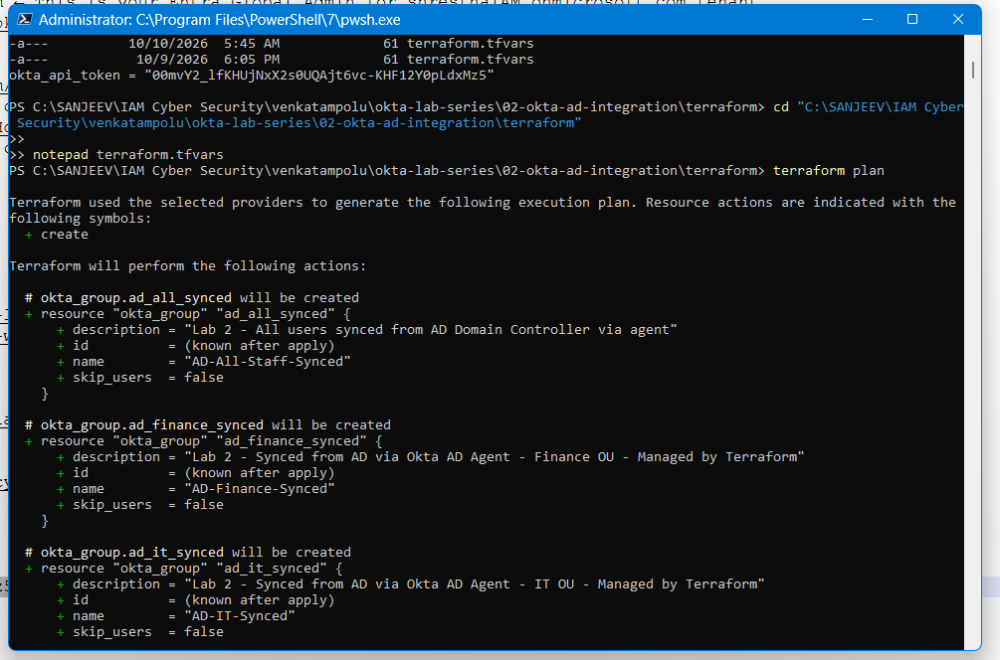
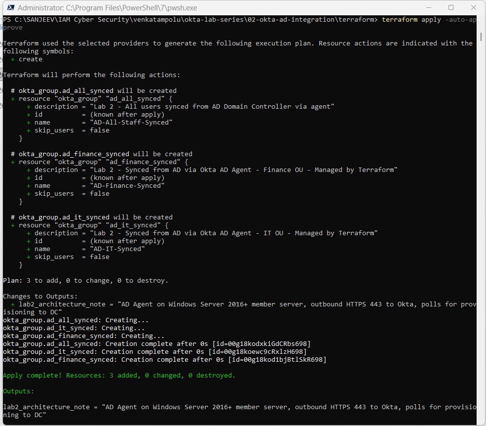
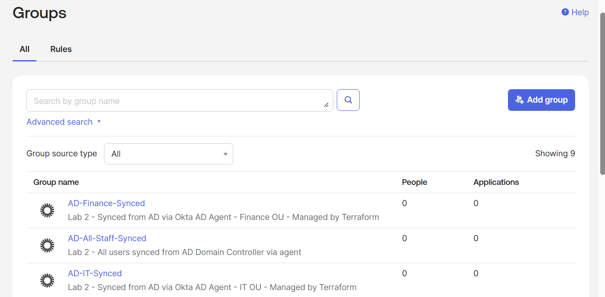
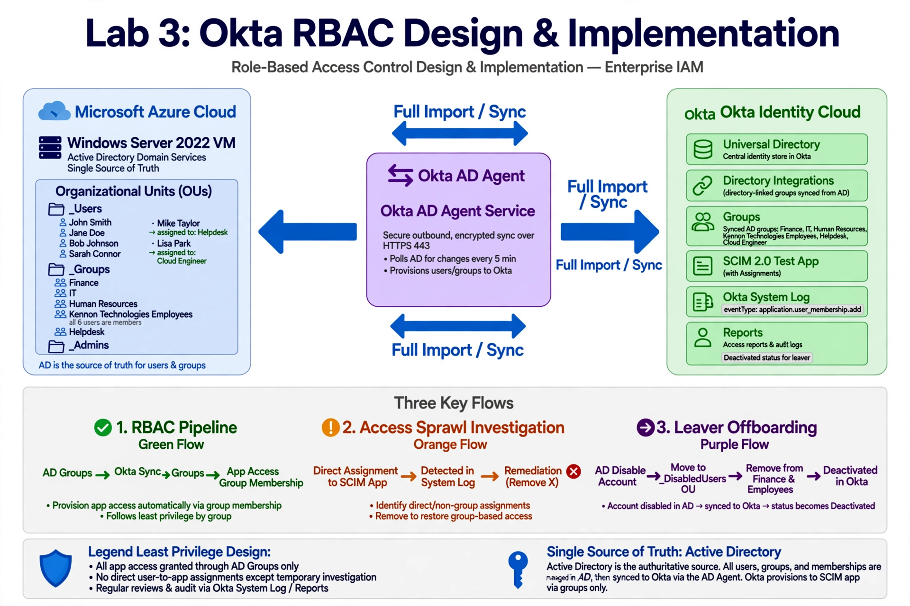

## Okta IAM Lab Series - Identity & Access Management with Terraform

Hands-on implementation of Enterprise IAM architecture using Okta Identity Cloud and Terraform IaC. Part of OCP Cyber Security Portfolio.

**Author:** Sanjeev Shrestha
**Location:** Allen, TX
**Stack:** Okta (trial-5500832.okta.com), Terraform v1.x, Okta Provider v4.20.0, PowerShell

## Architecture Overview

```
[On-Prem AD: IT OU, Finance OU, All Staff]
         |
         | AD Agent (Windows Server 2016+ member server)
         | Outbound HTTPS 443, polls Okta
         v
[Okta - trial-5500832.okta.com] <- Terraform creates groups here
         |
         v
[Cloud Apps via SSO]
```

## Labs Progress

### ✅ Lab 1 - Okta Tenant Setup
**Path:** `01-okta-tenant-setup/`
- Created Okta Developer Trial Tenant: `trial-5500832`
- Generated API Token for Terraform automation
- Configured `terraform.tfvars` and provider authentication
- `terraform init` + `terraform plan` validation
- Screenshots: tenant dashboard, API token creation

#### Architecture - Lab 1


**Flow:** Developer Workstation (Terraform v1.x, Okta Provider v4.20.0, PowerShell, `main.tf` blueprint + `terraform.tfvars` secret) → `terraform init` → `terraform plan` → `terraform apply` → Okta Identity Cloud (trial-5500832.okta.com - Admin Console, API Token generation, Universal Directory, Groups placeholder). Security via `.gitignore` (`.terraform/`, `*.tfstate`, `*.tfvars`, `api_token`), secrets management, token rotation, least privilege.

#### Screenshots - Lab 1





---

### ✅ Lab 2 - AD Integration (Current)
**Path:** `02-okta-ad-integration/`
**Objective:** Simulate AD sync to Okta via AD Agent architecture.

**Terraform Resources Created (via `terraform apply`):**
- `okta_group.ad_all_synced` - `AD-All-Staff-Synced` - ID: `00g18kodxkiGdCRbs698`
- `okta_group.ad_it_synced` - `AD-IT-Synced` - ID: `00g18koewc9cRxlzH698`
- `okta_group.ad_finance_synced` - `AD-Finance-Synced` - ID: `00g18kod1bjBtlSkR698`

**Key Learning:**
- AD Agent runs on Windows Server 2016+ member server, requires outbound HTTPS 443 to Okta, polls for changes, pushes to Domain Controller
- Terraform `main.tf` = blueprint (committed), `terraform.tfvars` = secret token (gitignored via `*.tfvars`), `terraform.tfstate` = state with real IDs (gitignored), `.terraform/` = provider plugins (gitignored)
- Groups verified in Okta Admin Portal: Directory > Groups > 9 groups including 3 synced (0 users expected - agent not installed, Terraform placeholder)

#### Architecture - Lab 2


**Flow:** On-Prem AD (Windows Server 2016+ Member Server, OUs: IT OU, Finance OU, All Staff) --LDAPS 636/Kerberos--> AD Agent Service (Outbound HTTPS 443 polls Okta API, Pushes to DC, TLS 1.2+ encrypted) --Secure API Sync--> Okta Identity Cloud (trial-5500832.okta.com). Verification: Directory > Groups shows 9 total (3 synced from AD + 6 native), 0 users expected as placeholder. Terraform files: `main.tf` committed blueprint, `terraform.tfvars` gitignored secret, `terraform.tfstate` gitignored state, `.terraform/` gitignored plugins, `.terraform.lock.hcl` committed version lock.

#### Screenshots - Lab 2





**Screenshots:**
- Terraform Plan - Plan: 3 to add
- Terraform Apply Success - Apply complete: 3 added
- Okta Portal Verification - Verified in Portal: Directory > Groups

---

### ⏳ Lab 3 - SSO Integration (Next) + RBAC Implementation
**Path:** `03-okta-rbac-design/`
**Based on:** `RyanKennon/Okta-RBAC` - Role-based access control model built in Active Directory and synced to Okta
- SAML app integration
- Group-based assignments
- RBAC design: Helpdesk, Cloud Engineer, Finance, IT, HR, Kennon Technologies Employees
- Access sprawl investigation via Okta System Log (`eventType equals application.user_membership.add`)
- Leaver offboarding & access revocation (AD Disable → Move to `_DisabledUsers` → Remove groups → Full Import → Deactivated in Okta)

#### Architecture - Lab 3


**Flow:**
1. **RBAC Pipeline:** AD Groups (Helpdesk, Cloud Engineer, Finance etc.) → Sync via Okta AD Agent (Full Import) → Okta Groups (directory-linked) → App Access via Group Membership (least privilege)
2. **SAML SSO:** User → Okta → SAML Assertion → Cloud Apps (SSO via group-based assignments)
3. **Leaver Offboarding:** AD Disable Account → Move to `_DisabledUsers` OU → Remove from Finance and Employees groups → Okta Full Import → Deactivated status in Okta (AD remains Single Source of Truth)
4. **Governance:** Access Sprawl Detection via Okta System Log filtering direct assignments, remediation by removing X assignment.
AD OUs: `_Users` (Mike Taylor → Helpdesk, Lisa Park → Cloud Engineer), `_Groups` (Helpdesk, Cloud Engineer, Finance, IT, HR, Kennon Technologies Employees), `_DisabledUsers`, `_Admins`, `_ServiceAccounts`.

#### Screenshots - Lab 3


---

## Security Practices
- `.gitignore` covers: `.terraform/`, `*.tfstate`, `*.tfstate.*`, `*.tfvars`, `api_token`
- API tokens rotated after exposure, never committed
- `terraform.tfvars` protected, verified via `git check-ignore`

## How to Run